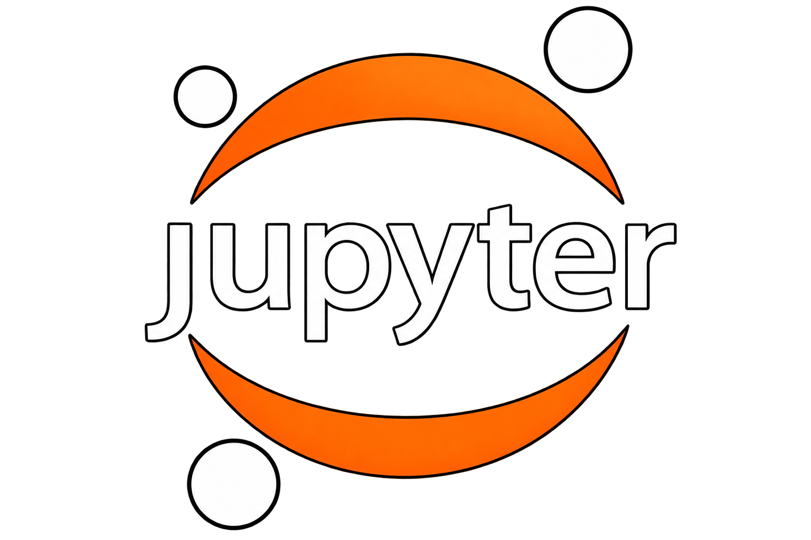
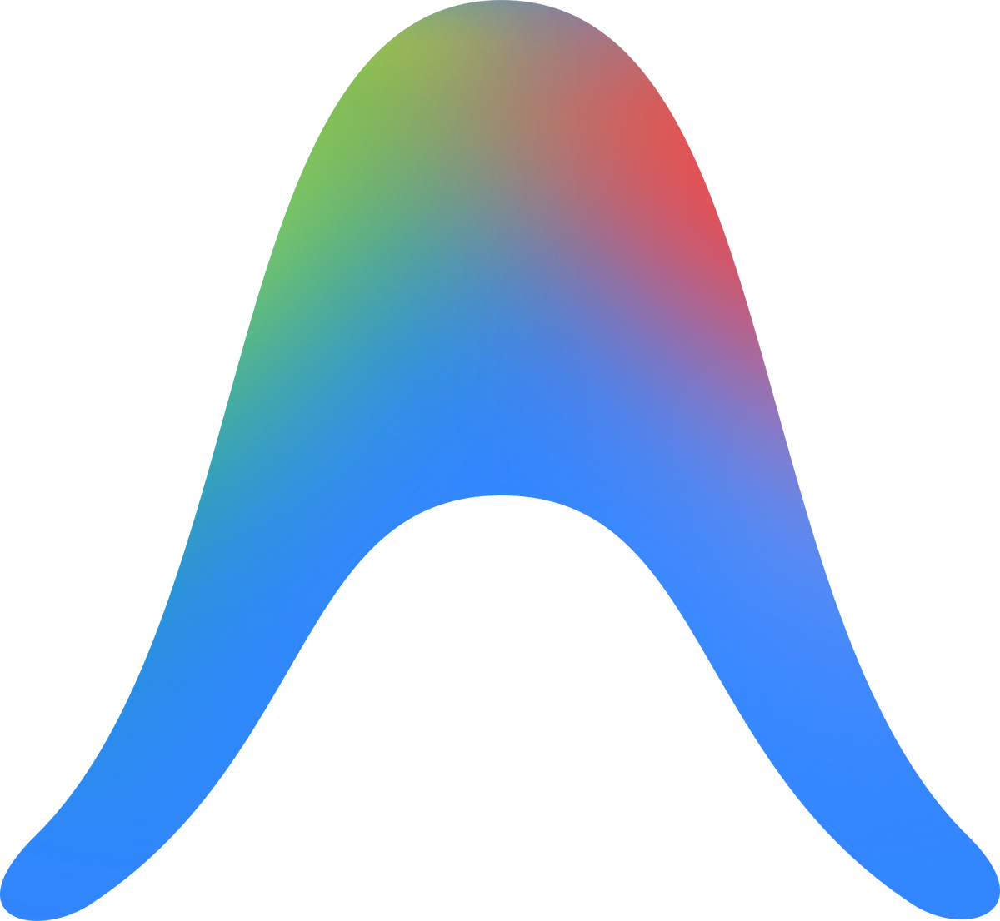
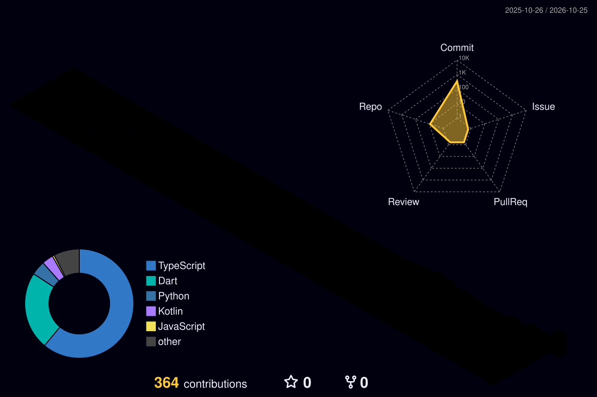

 

<strong>Artificial Intelligence &amp; Machine Learning</strong>

Machine Learning · Deep Learning · Computer Vision · LLMs

 

 

 

<table align="center">
<tr>
<td align="center" width="170" height="60">

</td>

<td align="center" width="170" height="60">

</td>

<td align="center" width="170" height="60">

</td>

</tr>
<tr>
<td align="center">
<a href="https://www.linkedin.com/in/anshul-dhiman-ai/">
<b>anshul-dhiman-ai</b>
</a>
</td>

<td align="center">
<a href="https://leetcode.com/u/anshul_ai/">
<b>anshul_ai</b>
</a>
</td>

<td align="center">
<a href="https://www.hackerrank.com/profile/anshuldhiman_ai">
<b>anshuldhiman_ai</b>
</a>
</td>

</tr>
</table>

---

<table>
<tr>
<td width="68%" valign="top">

<h3>AI/ML Engineer</h3>

I'm <strong>Anshul Dhiman</strong>, a <strong>B.Tech CSE (AI/ML) student</strong> exploring <strong>machine learning, deep learning, and AI systems</strong>.

I build practical AI solutions while continuously developing my <strong>DSA and problem-solving skills</strong>.

 

B.Tech CSE — AI/ML  
2nd Year · 3rd Semester

</td>
<td width="32%" align="center" valign="middle">

&nbsp;&nbsp;

&nbsp;&nbsp;

  

<b>MACHINE LEARNING · DEEP LEARNING · AI SYSTEMS</b>

</td>
</tr>
</table>

---

<h3>LANGUAGES</h3>
<table>
<tr>
<td align="center"> Python</td>
<td align="center"> C</td>
<td align="center"> C++</td>
<td align="center"> JavaScript</td>
<td align="center"> SQL</td>
</tr>
</table>

<h3>AI / ML &amp; DATA SCIENCE</h3>
<table>
<tr>
<td align="center"> NumPy</td>
<td align="center"> Pandas</td>
<td align="center"> Scikit-learn</td>
<td align="center"> TensorFlow</td>
<td align="center"> PyTorch</td>
</tr>
</table>

<h3>DEVELOPMENT &amp; DATABASES</h3>
<table>
<tr>
<td align="center"> MongoDB</td>
<td align="center"> FastAPI</td>
<td align="center"> React</td>
<td align="center"> Git</td>
<td align="center"> GitHub</td>
<td align="center"> VS Code</td>
<td align="center"> Jupyter</td>
</tr>
</table>

---

<table>
<tr>
<td align="center" width="140" height="120"> <b>Claude Code</b></td>
<td align="center" width="140" height="120"> <b>Antigravity</b></td>
<td align="center" width="140" height="120"> <b>Codex</b></td>
<td align="center" width="140" height="120"> <b>Devin</b></td>
<td align="center" width="140" height="120"> <b>Cursor</b></td>
</tr>
</table>

---

<table cellspacing="30">
<tr>

<td width="50%" valign="top">

<h3>01 · BATUA</h3>

<strong>Personal Finance Manager for INR</strong>

Local-first expense tracking with NLP, analytics, and budgeting.

 

&nbsp;
&nbsp;
&nbsp;

Python · FastAPI · React · MongoDB

 

</td>

<td width="50%" valign="top">

<h3>02 · CURRENCY COUNTER</h3>

<strong>Real-time Currency Exchange Tool</strong>

Multi-currency converter with live rates and history tracking.

 

&nbsp;
&nbsp;

JavaScript · HTML · CSS

 

</td>

</tr>
<tr>

<td>

<a href="https://github.com/anshuldhiman-ai/Batua">
<b>VIEW REPOSITORY →</b>
</a>

</td>

<td>

<a href="https://github.com/anshuldhiman-ai/Currency-Counter">
<b>VIEW REPOSITORY →</b>
</a>

</td>

</tr>
</table>

---

 

---

 

---

---

<h3>BUILDING · LEARNING · SOLVING</h3>

